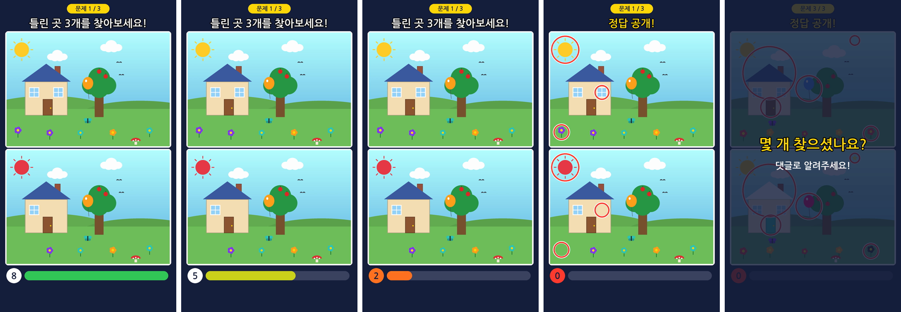

# 007. 틀린그림 찾기 쇼츠 (프로토타입)

두 그림을 위아래로 보여주고, 하단 타이머 바가 줄어드는 동안 틀린 곳을 찾게 한 뒤 정답을 표시하는 **세로형 쇼츠 MP4**를 자동으로 만든다.

- 아이디어 문서: [ideas/007-spot-the-difference/idea.md](../../ideas/007-spot-the-difference/idea.md)
- 외부 AI·유료 API 호출: **없음** (그림은 코드로 그리고, 영상은 로컬 FFmpeg로 만든다)



## 영상 구성 (기본값: 3문제, 약 40초)

| 구간 | 길이 | 화면 | 소리 |
|---|---|---|---|
| 시작 | 1초 | "문제 1 / 3", "틀린 곳 N개를 찾아보세요!" | 띠링 |
| 카운트다운 | 8초 (`--time`) | 하단 타이머 바가 줄어든다. 초록 → 노랑 → 빨강, 남은 초 표시, 마지막 3초는 숫자가 커졌다 작아진다 | 매초 째깍 (마지막 3초는 더 크게) |
| 정답 공개 | 틀린 곳 × 0.6초 + 1.6초 | 위·아래 그림에 빨간 원이 하나씩 나타난다 | 시간 종료 부저, 원마다 띵 |
| 마무리 | 2.5초 | "몇 개 찾으셨나요? 댓글로 알려주세요!" | 마무리 효과음 |

문제는 갈수록 어려워진다: 1번 쉬움(큰 물체 3곳) → 2번 보통(4곳) → 3번 어려움(작은 물체 포함 5곳).

## 틀린 그림을 만드는 방법

**기본 모드 (코드로 그린 풍경, 추천)**: 집·나무·사과·꽃·새·풍선·버섯·나비 등으로 이루어진 풍경을 seed에 따라 매번 다르게 그린다. 그림 B는 물체 몇 개만 **지우거나 / 색을 바꾸거나 / 새로 추가**해서 다시 그린다. 그래서 두 그림은 정답 위치 안에서만 다르고 그 밖은 한 픽셀도 다르지 않다 (테스트로 확인).

**내 그림 모드 (`--image`)**: 가지고 있는 그림(예: AI로 만든 그림) 한 장에서 둥근 영역 몇 곳의 색을 바꾸거나, 좌우를 뒤집거나, 다른 곳 조각을 붙인다. 눈에 띄는지 자동으로 확인하지만, 지금은 **고친 자리가 얼룩처럼 보이는 경우가 있다**. 자연스러운 결과를 내려면 AI 이미지 편집(인페인팅)을 연결해야 한다 (다음 단계).

## 실행

필요한 것: Python 3.10 이상, FFmpeg

### Windows

탐색기에서 **`make-windows.bat`을 더블클릭**한다. 처음 한 번 패키지를 설치하고 쇼츠를 만든 뒤 `out` 폴더를 연다.
옵션은 명령 프롬프트에서 `make-windows.bat --seed 7 --time 10`처럼 붙인다.

### 직접 실행

```bash
cd projects/007-spot-the-difference
python3 -m venv .venv && source .venv/bin/activate   # Windows: .venv\Scripts\activate
pip install -r requirements.txt
python -m spotdiff                     # out/shorts.mp4 생성
```

| 옵션 | 설명 |
|---|---|
| `--puzzles 3` | 문제 수 |
| `--seed 7` | 같은 seed면 같은 그림 (기본: 무작위, 결과에 출력됨) |
| `--time 8` | 문제당 제한 시간(초) |
| `--level 0/1/2` | 난이도 고정 (기본: 문제마다 점점 어렵게) |
| `--image a.png --image b.png` | 내 그림으로 문제 만들기 (그림 하나에 문제 하나) |
| `--font 경로.ttf` | 한글 글꼴 (기본: 맑은 고딕, Apple SD 고딕 Neo, Noto CJK, 나눔고딕 자동 탐색. 환경 변수 `SPOTDIFF_FONT`도 가능) |
| `--no-video` | MP4 없이 그림과 정답만 |
| `--out out` | 결과 폴더 |

### 결과물 (`out/`)

| 파일 | 내용 |
|---|---|
| `shorts.mp4` | 1080x1920, 30fps, H.264 + AAC |
| `puzzleN_a.png`, `puzzleN_b.png` | 원본 / 틀린 그림 |
| `puzzleN_answer.png` | 정답 원 표시 (업로드 전 확인용) |
| `puzzles.json` | seed, 난이도, 틀린 곳 종류와 좌표 |

## 테스트

```bash
pip install -r requirements-dev.txt
python -m pytest
```

- 여러 seed·난이도에서 **정답 상자 밖은 픽셀이 하나도 다르지 않은지**, 정답마다 눈에 띌 만큼 바뀌었는지, 정답끼리 겹치지 않는지 확인
- FFmpeg가 있으면 실제로 MP4를 만들어 해상도·오디오·길이 확인

## 구성

| 파일 | 내용 |
|---|---|
| `spotdiff/scene.py` | 풍경 그리기, 물체를 지우기/색 바꾸기/추가해서 틀린 곳 만들기 |
| `spotdiff/photo.py` | 내 그림으로 틀린 곳 만들기 |
| `spotdiff/video.py` | 화면 배치, 타이머 바, 정답 원, 효과음 합성, FFmpeg 인코딩 |
| `spotdiff/__main__.py` | 명령줄 실행 |

## 알려진 한계 / 다음 단계

- 쇼츠 앱은 화면 아래쪽에 제목·채널명, 오른쪽에 버튼을 겹쳐 보여준다. 타이머 바는 그림 바로 아래(위에서 약 1690px)에 두어 최대한 가리지 않게 했지만, 아래쪽 그림의 오른쪽 아래 부분은 버튼에 일부 가려질 수 있다.
- 풍경 종류가 하나(집·나무·들판)뿐이다. 바다·우주·방 안 같은 테마를 추가하면 시리즈로 만들기 좋다.
- 내 그림 모드는 AI 이미지 편집(예: 006에서 연결한 Gemini)으로 바꾸면 훨씬 자연스러워진다. 유료 호출이라 승인 후 진행한다.
- 배경 음악, 채널 로고, 제목 문구 바꾸기 옵션은 아직 없다.
